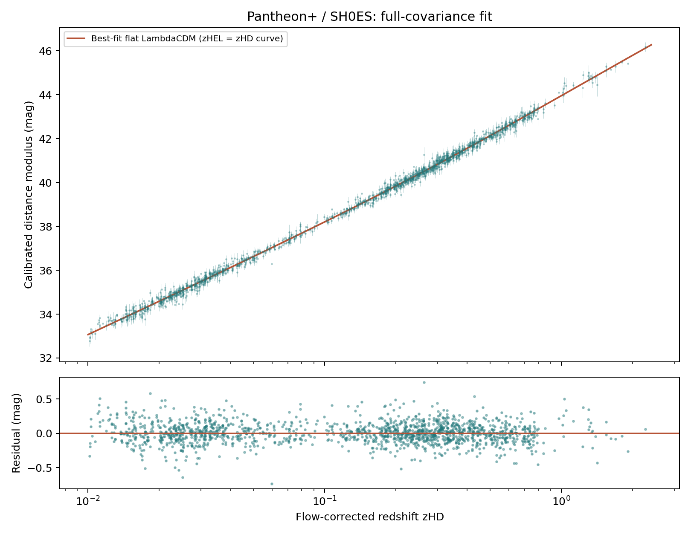

# Cosmic Expansion Lab

An interactive observational-cosmology website and reproducible Python analysis connecting **redshift → Cepheid calibration → Type Ia supernova distances → cosmic expansion**.



## Version 2: deeper investigations

**[Open the public website](https://biswajit1999.github.io/cosmic-expansion-lab/)** · [Research methods and results](docs/RESEARCH.md) · [Executed notebook](notebooks/expansion-investigations.ipynb)

The expanded project adds three credited Hubble observations, four computed scientific figures, a distance-and-lookback-time calculator, an interactive likelihood landscape, redshift-cut sensitivity tests, an uncalibrated SN-only fit, and a constant-w dark-energy model. A field guide explains acceleration, distance definitions, BAO rulers, gravitational-wave sirens, and common misconceptions.

The imagery is observational; the research figures are generated from the analysis. See [image credits and usage](web/assets/CREDITS.md). BAO, sirens and CMB are explained but are not fitted as additional raw datasets.

## Great Attractor research direction

The [research design and literature review](docs/GREAT_ATTRACTOR_RESEARCH_PLAN.md) asks whether independent distance tracers can distinguish localized convergence from external flows and calibration effects, and which additional observations would resolve the ambiguity. It explains the connection to the Planck CMB map and the limits of the current inputs. This is a proposed experiment, not a new attractor detection or a claim of established novelty.

The completed [input audit](results/flow-input-audit.json) identifies 563 nearby non-calibrator light-curve records (446 distinct literal CID labels) in `0.005 < zCMB < 0.05`. Reproduce the inventory and [sampling figure](results/flow-input-footprint.png) with `python analysis/audit_flow_inputs.py` after downloading the inputs. Repeated records and shared calibration must be modeled before fitting flows.

## Explore locally

The browser assets and derived dataset are checked in. No Node packages or build step are required.

```sh
python -m http.server 8000 --directory web
```

Open http://localhost:8000. Use HTTP rather than opening `index.html` directly, because the application fetches JSON.

- **Expanding space:** change scale factor, play forward in cosmic time, move the observer, and compare a matter-only universe with a Planck-like flat ΛCDM model.
- **Supernova evidence:** inspect real measurements and preview different H₀ / Ωₘ curves or residuals.
- **Distance ladder:** examine actual Cepheid-host calibrators, their distances and standardized SN brightnesses.
- **Redshift & Doppler:** use measured heliocentric redshifts to compare wavelength stretching, `cz`, and the special-relativistic Doppler equivalent. The waves and example spectral lines are illustrations, not raw observed spectra.
- Search and download all 1,701 light-curve records, containing 1,543 distinct literal CID labels in this pinned release (see the catalog-identity note in docs/RESEARCH.md). Repeated light curves retain their covariance.

## Reproduce the science

Python 3.10+ is recommended. The tested environment used Python 3.9.19, NumPy 1.26.4 and SciPy 1.10.1.

```sh
python -m venv .venv
# Windows: .venv\Scripts\activate
# macOS/Linux: source .venv/bin/activate
python -m pip install -r requirements.txt
python analysis/download_data.py
python analysis/fit.py
python analysis/research.py
python -m unittest discover -s tests
```

The downloader obtains the table and full covariance (about 34 MB total) from immutable upstream commit `c447f0fea703fcd0fff57de5000947b5ca81286b`. SHA-256 hashes in `data/provenance.json` are checked on every run. Raw downloads are ignored by Git; the derived browser data and fitted results are versioned.

Outputs:

- `web/data/results.json`: fit values, selection, covariance of parameters, χ² and degrees of freedom.
- `web/data/supernovae.json` / `.csv`: derived measurement catalog, with original row index and survey ID.
- `results/hubble-diagram.png` / `.pdf`: scientific export plots.

## Analysis and initial results

| Fit | Selection | Free parameters | H₀ (km/s/Mpc) |
| --- | --- | --- | --- |
| Wider SN + Cepheid | `zHD > 0.01 OR IS_CALIBRATOR` | H₀, M_B, Ωₘ | 73.53 ± 1.02 |
| Local ladder | `USED_IN_SH0ES_HF OR IS_CALIBRATOR` | H₀, M_B; Ωₘ fixed at 0.3 | 73.53 ± 1.05 |

The wider fit gives Ωₘ = 0.3318 ± 0.0180 and χ² = 1452.02 for 1654 degrees of freedom. The two fits share observations and **are not independent**. Errors are local Gaussian curvature estimates from the full supplied covariance, without reduced-χ² rescaling. They are not MCMC credible intervals.

The likelihood follows the released Pantheon+ / SH0ES compressed likelihood: calibrators use the supplied Cepheid host modulus; other SNe use flat-ΛCDM luminosity distances. We integrate at flow-corrected `zHD` and use `(1 + zHEL)` for the luminosity-distance prefactor. Cepheid-host uncertainty is already in the covariance and is not added again. The table's diagonal error columns are not used to fit parameters. Upstream matrix asymmetry of at most 3×10⁻⁸ from decimal serialization is symmetrized before Cholesky factorization.

Read [the methodology](docs/METHODOLOGY.md) for equations, assumptions and validation.

## Scope

This project fits released standardized SN and compressed Cepheid-host distance products. It does **not** refit raw Cepheid photometry, calibrate spectral pixels, fit CMB maps, or replicate every analysis variant of SH0ES. The 2022 SH0ES result (73.04 ± 1.04) and Planck 2018 result (67.4 ± 0.5) appear only as explicitly dated published references. Do not interpret differences from those reference numbers as a new cosmological discovery.

The expansion animation is illustrative, has no boundary or preferred center, and does not depict galaxies or bound systems themselves expanding. It is independent of the SN fit and uses H₀ = 67.4, Ωₘ = 0.315. Radiation, curvature, evolving dark energy and peculiar galaxy motions are not simulated.

## Sources and attribution

- [Pantheon+ / SH0ES public data release](https://github.com/PantheonPlusSH0ES/DataRelease), pinned in the provenance manifest.
- [Brout et al. 2022, cosmological constraints](https://arxiv.org/abs/2202.04077).
- [Riess et al. 2022, Cepheid distance ladder](https://arxiv.org/abs/2112.04510).
- [Planck 2018 VI, cosmological parameters](https://arxiv.org/abs/1807.06209).
- [NASA: cosmological redshift](https://science.nasa.gov/mission/hubble/science/science-behind-the-discoveries/hubble-cosmological-redshift/).

Original code is MIT licensed. Scientific data products retain their upstream attribution and applicable terms; the code license does not relicense them. Fonts use Google Fonts with system-font fallbacks; the scientific app needs no external JavaScript services.

## Repository layout

```text
analysis/       Download, cosmological functions, full-covariance fitting
data/           Input provenance; raw inputs downloaded on demand
docs/           Scientific methodology
results/        Generated scientific figures
tests/          Independent numerical checks and scientific invariants
web/            Buildless static application and derived data
```

CI checks numerical tests, JavaScript syntax and derived-data integrity. The site can be hosted on any static host by publishing `web/`. No hosting service is required for local use.

## Work through the notebook

Install the optional notebook dependencies with `python -m pip install -r requirements-notebooks.txt`. Open `notebooks/expansion-investigations.ipynb` in Jupyter or an editor with notebook support. It contains executed results and can be rerun inside this checkout. `python scripts/build_notebook.py` rebuilds and executes the notebook from its source, then copies it to the website download directory.

GitHub Pages publishes `web/` automatically after the workflow checks pass on `main`. The public website does not need a Python server; Python is used for reproducible analysis and local preview.
