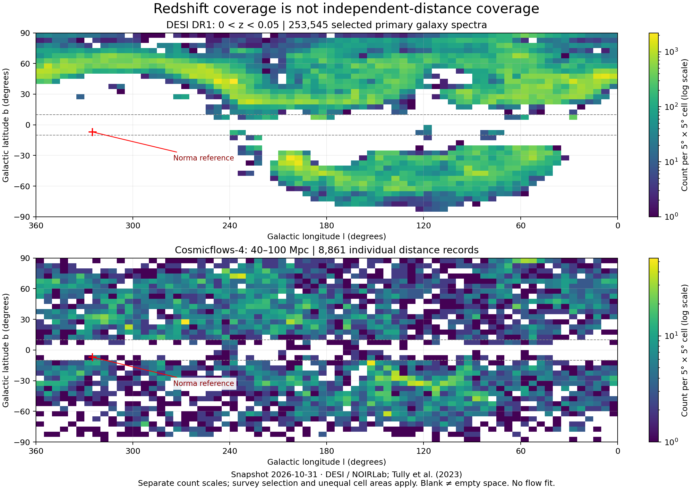

# Galaxy catalog inventory: measured scale and usable information

Snapshot: 31 October 2026. **Inventory only; no new peculiar-velocity field, mass estimate or dark-energy result is fitted.**

## Actual data processed

| Product | Verified inventory | Representation in this project |
| --- | ---: | --- |
| DESI DR1, NOIRLab `desi_dr1.zpix`, documented selection below | 14,140,375 selected primary galaxy spectra | Server-side aggregation into 39,364 occupied angular/redshift cells; independent COUNT(*) agrees exactly |
| Cosmicflows-4 journal Table 2 | 55,877 galaxy records; 55,877 distinct PGC identifiers | Entire individual table parsed locally; normalized records available as JSON and CSV |
| Example Norma-direction selection | 389 CF4 records within 20°; 126 also at modulus-derived distances of 40–100 Mpc | Exploratory inventory, not independent constraints or a fitted basin |

We did not download 14 million individual DESI spectra, and do not claim a billion- or trillion-galaxy measurement catalog. Imaging detections, redshift measurements, distance indicators, simulation particles and independent constraints are different quantities. The important question is whether the right measurements cover the relevant volume with controlled errors.

## DESI selection and aggregation

The query covers all survey/program entries in the public table satisfying `zcat_primary='true'`, `spectype='GALAXY'`, `zwarn=0`, `0<z<2`, `0<=glon<360`, and `-90<=glat<90`. ZCAT_PRIMARY chooses the catalog's preferred spectrum for a target. We rely on that flag and have not independently cross-matched physical identities across catalogs. This selection is not the DESI LSS cosmology sample and is not identical to the headline Main Survey count.

Aggregate coordinates are `floor(glon/5)`, `floor((glat+90)/5)` and `floor(z/0.05)`. The exact ADQL, endpoint, result limits and response hashes are in [catalog-provenance.json](../data/catalog-provenance.json). The service accepts ordinal grouping (`GROUP BY 1,2,3`). A separate COUNT(*) with identical cuts returns 14,140,375; the cell-count sum equals this. There are fewer bins than the requested MAXREC=200000, and the parser rejects an XML error document or a potential truncated result.

These rectangular cells have unequal solid angle. Their colours encode counts, rescaled within the selected view, not completeness-corrected density. Survey targeting, dust, redshift failures and masks have not been modeled. A blank cell cannot be called a void. The Galactic |b|=10° reference band is not a completeness mask. Redshift filters use exact multiples of the stored Δz=0.05 bins; no fractional-bin counts are invented.

The source describes DESI wavelengths in a barycentric convention. We have not transformed DESI redshifts to the CMB frame, nor joined them to CF4. Do not subtract a CF4 distance-based Hubble velocity from an unmatched DESI row and call it a measured peculiar velocity.

## Cosmicflows-4 measurements

The input is the full machine-readable **Distances of Individual Galaxies** table attached to [Tully et al. (2023)](https://doi.org/10.3847/1538-4357/ac94d8). Its published byte-by-byte schema is retained in the original source. The parser preserves PGC ID, group-reference PGC, Tempel group identifier, equatorial and Galactic coordinates, CMB-frame systemic velocity, combined distance modulus, its marginal uncertainty, and a bit mask of available methods.

| Bit index | Method | Records with a measurement |
| --- | --- | ---: |
| 0 | SN Ia | 1,004 |
| 1 | Tully–Fisher | 12,222 |
| 2 | Fundamental Plane | 42,223 |
| 3 | Surface brightness fluctuations | 469 |
| 4 | SN II | 94 |
| 5 | Tip of the red giant branch | 446 |
| 6 | Cepheids | 69 |
| 7 | Masers | 6 |

Counts overlap; their sum is not a galaxy count. The combined modulus comes from the authors' multi-method MCMC calibration. Selecting a method means the method is present in that record; it does not turn the displayed combined modulus into a method-specific independent measurement. The original table supplies individual method values if a later analysis needs them.

The displayed distance is the direct transform `D/Mpc = 10**((mu-25)/5)`. Its interval transforms `mu ± sigma_mu` separately, preserving asymmetry. It is not claimed to be the posterior mean distance. `Vcmb` is systemic velocity in the CMB reference frame, not peculiar velocity. We do not substitute `Vcmb/c` for a precision cosmological redshift.

The exploratory cone is centred at Galactic `(l,b)=(325°,−7°)` with a 20° great-circle radius. It is a reference direction toward Norma, not a new estimate of the attractor's position. Distance and angular cuts describe this inventory only. Distinct PGC IDs do not make records independent: group motion, repeated anchors and calibration tie them together.

## Reproduction and scope

The standalone [PDF figure](../results/catalog-coverage.pdf) compares the DESI low-redshift footprint (253,545 selected spectra at 0<z<0.05) with the CF4 40–100 Mpc distance shell (8,861 records). These are different selections, not identical volumes or matched objects. Reproduce it with `python analysis/plot_catalog_coverage.py` after building the inventory.

Run `python analysis/catalog_scale.py --fetch` to fetch missing inputs, validate and rebuild. The default command without `--fetch` works offline with the source cache. The CF4 source is hash pinned. DESI is a live public database: response byte order may change, so canonical bins and counts must match the archived snapshot before regeneration. If the catalog changes, deliberately curate a new snapshot; do not silently relabel it as the old one.

The browser loads complete CF4 normalized records and the DESI binned inventory. It filters locally, paginates the record table, exports the selected records/bins and shares query parameters. It does not draw millions of invented particles as if each had a measured 3D trajectory. Full raw DESI records, per-object spectra and their error distributions are not part of this release.

Data citations, required DESI acknowledgment text and transformations are recorded in [ACKNOWLEDGMENTS.md](../web/data/catalogs/ACKNOWLEDGMENTS.md). The software MIT license does not replace data terms. CF4 table access through the journal succeeded; CDS access was unavailable during this run.

## Next inference stage

This release replaces a small illustrative sample with a measured inventory at survey scale. It does not solve the Great Attractor inverse problem. The next stage is to reconcile catalog identities and groups, compare redshift frames, obtain covariance and selection information, and implement a forward likelihood in distance-indicator observables. Compare localized convergence with external-flow alternatives using injected mocks and held-out groups/methods, as specified in the [research plan](GREAT_ATTRACTOR_RESEARCH_PLAN.md).

The 126-record local example highlights why adding millions of distant redshifts alone does not resolve missing distance information near the target. A billion-source image catalog may help identify targets and selection effects, but it cannot replace independent distances and uncertainty modeling. The number of simulated particles is a numerical-resolution choice, not an observational sample size.

Sources: [DESI DR1 release](https://doi.org/10.3847/1538-3881/ae4c43), [NOIRLab table and quality documentation](https://datalab.noirlab.edu/data/desi), [DESI data license](https://data.desi.lbl.gov/doc/acknowledgments/), [CF4 release](https://doi.org/10.3847/1538-4357/ac94d8).
