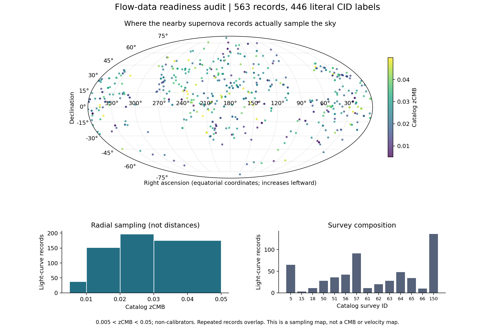

# What can we actually identify about the Great Attractor?

Research design and data-readiness audit · 29 October 2026

**Status:** proposed experiment, with a completed inventory of this repository's supernova inputs. No new attractor detection, mass estimate, CMB measurement, or rejection of ΛCDM is reported here. Novelty remains provisional after a targeted literature review.

## The proposed problem statement

> Can independent distance tracers identify a localized convergence of the peculiar-velocity field in the Great Attractor region once external tidal flows, shared distance calibration, and the actual survey selection are included? Where do existing measurements fail to distinguish these explanations, and which additional distances would most efficiently break that ambiguity?

The intended output is a **map of where the competing explanations are distinguishable**, accompanied by predictions for observations withheld from fitting. The scientific value could be a robust local-flow measurement, a demonstrated degeneracy, or an observation plan that resolves it. A dramatic cosmological anomaly is not required for success.

## Expansion and attraction are compatible

For physical separation **r** = a(t)**x**, differentiating gives

\[
\dot{\mathbf r}=H(t)\mathbf r+\mathbf v_{\rm pec},
\qquad \mathbf v_{\rm pec}=a\dot{\mathbf x}.
\]

The first term describes the background expansion; the second describes motion relative to it. Matter overdensities and underdensities generate peculiar flows. There is no requirement that every galaxy move exactly with the background, nor that all galaxies move toward one attractor. A velocity field inferred from radial data is also model-dependent: most galaxies do not have measured three-dimensional velocities. Density/velocity reconstructions already show multiple attracting structures and flows away from underdense regions [1, 2].

For an illustrative line of sight, H₀ = 70 km/s/Mpc and distance 70 Mpc give a background contribution of 4,900 km/s. A peculiar contribution of −500 km/s leaves a positive approximate recession velocity of 4,400 km/s. These are teaching numbers, not a fit to the Great Attractor. Cosmological redshift and Doppler shifts must be combined multiplicatively in a real fit [3].

Three distinct quantities must remain separate: convergence of a *peculiar* velocity field, a zero of its projected radial component in a specified reference frame, and a turnaround surface where physical separation stops increasing. None automatically establishes that an entire supercluster is bound or will collapse. A feature called an attractor can itself participate in a larger-scale flow.

## What the oval Planck map contributes

The familiar cleaned CMB temperature map shows radiation primarily released when the Universe was about 380,000 years old. The first Planck cosmology map was released in 2013; the ancient date refers to emission, not when the spacecraft took the observations [4]. The conventional anisotropy map removes the mean temperature and dominant dipole and separates foreground emission [5]. It is not a picture of nearby mass.

The last-scattering surface is a distant shell, whereas our galaxy catalog samples a nearby three-dimensional volume. Matching a present-day supercluster to a similarly placed hot or cold patch does not identify its primordial ancestor. Temperature anisotropy is not a one-to-one local density map.

There are three legitimate connections:

1. **Reference frame:** the measured CMB dipole constrains our motion under its standard kinematic interpretation. Solar-system and Local-Group velocities are different. If this dipole defines the catalog's CMB-frame redshift, agreement with that imposed correction is not an independent confirmation of the flow.
2. **Statistical prediction:** Planck cosmological constraints and the initial fluctuation spectrum supply a ΛCDM distribution of possible velocity fields. Compare simulations passed through the *same survey window and estimator* with the observations. This is a distribution of realizations, not an exact prediction of the local mass arrangement from the oval image.
3. **A secondary signal:** moving ionized gas scatters CMB photons, producing the kinetic Sunyaev–Zeldovich effect (kSZ). Approximately, ΔT/T = −τv_los/c for a coherent gas cloud, with optical depth τ and positive receding velocity. Planck velocity–temperature cross-correlations already exist [6]. A Great Attractor test would require numerical maps, beams, masks, foreground treatment, gas/optical-depth modeling, and a forecast of the measurement uncertainty. The displayed JPEG cannot serve as the dataset.

kSZ is a conditional second stage. Primary CMB fluctuations, foregrounds, beam smoothing, and uncertain gas physics may prevent Planck from discriminating these particular flow models. A forecast that establishes this limit is useful; it must not be presented as a detection. Shared reconstruction inputs must also be tracked before calling it independent.

## What the literature already covers

| Existing work | Consequence for this project |
| --- | --- |
| Dressler & Monson, *Return to the Great Attractor*, 2026 preprint, v2: SBF distances and reported convergence near 70 Mpc [7] | Testing local convergence or a connection to the CMB dipole is already an explicit research program. |
| Watkins, Clark & Feldman, *The Origins of the Bulk flow*, published 2026: internal/external decomposition of Cosmicflows-4 [8] | Decomposing local and distant causes is not new by itself. Their large-scale statistic differs from a targeted regional convergence measurement. |
| Carrick et al., 2015: 2M++ density predictions compared with distance tracers, including external flow [1] | A density template plus residual bulk flow is established methodology. |
| Watkins, Feldman & Hudson, 2009: survey-window-aware bulk-flow estimation [9] | Uneven sky coverage and comparisons between differently weighted surveys are longstanding issues. |
| Carr et al. and Peterson et al., Pantheon+ redshift/velocity treatment [3, 10] | Reference-frame and flow-correction sensitivity cannot be claimed as an untouched topic. |
| Planck kSZ cross-correlation [6] | Combining galaxy velocities with CMB maps is also established. |

The possible contribution is a tightly specified *combined experiment*: estimate how much evidence for localized convergence survives calibration and external-field freedom, validate it on held-out distance methods, and publish a map of the additional measurements needed to decide between the models. This review does **not** establish that nobody has implemented that exact combination. A systematic citation search and review by a peculiar-velocity specialist remain necessary before making a priority claim.

The two recent studies motivate a comparison; their headlines alone do not establish a statistical contradiction. Match spatial domains, smoothing, frames, distance calibration and weighting before comparing conclusions [7, 8].

## What we have measured about our own data

The reproducible inventory in [flow-input-audit.json](../results/flow-input-audit.json) verifies the input hash against [the provenance manifest](../data/provenance.json). Its exploratory selection is valid RA/DEC, non-calibrators, and **0.005 < zCMB < 0.05**. These limits are for inventory only; the eventual science selection must be justified and frozen before evaluating the proposed tests.

| Inventory quantity | Result |
| --- | ---: |
| Total light-curve records | 1,701 |
| Records with valid coordinate ranges | 1,701 |
| Selected nearby non-calibrator records | 563 |
| Distinct literal CID labels in that subset | 446 |
| Survey IDs in that subset | 14 |
| Rows in zCMB intervals (0.005–0.01, 0.01–0.02, 0.02–0.03, 0.03–0.05) | 38, 152, 197, 176 |

Literal labels are not a resolved physical-object count. Repeated light curves, common hosts, group membership and shared calibrators require explicit accounting. Radial bins use redshift, not independently measured distance. The footprint below does not measure completeness.



The table supplies RA, DEC, standardized brightness, zHEL, zCMB, zHD, VPEC, uncertainty columns and survey IDs. The critical distinction is that zCMB corrects observer motion, while zHD additionally uses a source peculiar-velocity model [3]. In this selected subset, the median absolute value of c[(1+zCMB)/(1+zHD)−1] is **126.16 km/s**. This is a first-order velocity equivalent of a correction already applied to the catalog; it is **not** our independent measurement of a bulk flow.

Our existing full-covariance expansion fit is valid for its documented compressed likelihood. A flow experiment cannot simply replace zHD with zCMB and retain every uncertainty assumption unchanged. Audit the released covariance's peculiar-velocity terms, group redshifts, redshift-dependent standardization/bias corrections and calibrator correlations. Obtain the component products needed to replace the relevant uncertainty contributions without double counting. Until this is done, alternative-redshift fits are sensitivity diagnostics, not a validated new likelihood.

We have not yet ingested independent distance-tracer catalogs, density reconstructions, or Planck numerical maps for this experiment. Cosmicflows-4 offers 55,877 galaxies in 38,065 groups using several methods, but it includes supernovae and shared distance anchors [11]. Concatenating it with Pantheon+ would not create an independent dataset.

## A falsifiable experiment

### 1. Freeze the observable and reconcile identities

Fit measured standardized magnitudes or native distance indicators jointly with redshifts; introduce latent distances rather than treating noisy distance estimates as exact positions. Carry tracer zero points, selection/Malmquist effects, group membership, repeated measurements, calibration covariance and small-scale velocity scatter. For the flow likelihood, source-flow corrections must be modeled, rather than silently inherited as measured velocities. Keep observer-frame transformations explicit.

Build a cross-catalog identity and calibration graph. Assign all observations of the same physical system to the same validation block. Methods sharing anchors may still be used, but their shared calibration parameters belong in the joint model.

### 2. Compare nested explanations on the same footprint

Use a common background cosmology and common nuisance treatment. An initial model family is

\[
u_i=\hat{\mathbf n}_i\!\cdot\![\mathbf v_{\rm other}(\mathbf r_i)
+ A_{\rm GA}\mathbf v_{\rm GA}(\mathbf r_i)
+\mathbf B+\mathbf S\mathbf r_i]+\epsilon_i.
\]

Here u is the source radial peculiar component; **v**GA is a predeclared extended density-derived template, not an arbitrary point mass. **v**other includes other resolved structures and voids. **B** and the symmetric trace-free tensor **S** describe external bulk motion and shear over the fitted volume. Their units and coordinate origin must be fixed. This is a controlled starting approximation: test more flexible external fields and alternative density reconstructions before drawing physical conclusions, since a uniform external flow can be inadequate [8].

Compare AGA = 0 with AGA free while keeping other components and nuisance freedoms matched. A fitted amplitude is conditional on the density template and its uncertainty; it is not automatically a unique GA mass measurement. A baseline with no coherent peculiar flow is a pipeline diagnostic, not the sole scientific competitor.

Predict both the near and far side, and off-axis control regions. A sign change after accounting for other motions can help locate convergence, but a projected zero depends on reference frame and external flow. Estimate the probability and uncertainty of a convergence region rather than forcing every posterior realization to contain one.

### 3. Establish whether the experiment can distinguish its own hypotheses

Generate mock observations with the actual footprint and an estimated selection model, distance uncertainties, correlated calibration shifts, repeated observations and group velocities. Inject localized convergence, external flow without that convergence, their mixture, and plausible calibration/selection failures. Refit every case through the same pipeline.

Report parameter bias, interval coverage, mistaken-attractor frequency and power across injected signal strengths. Use realistic alternative templates to test model misspecification. A successful recovery of the model used to generate mocks alone is insufficient. Sparse coverage behind the Milky Way must appear as uncertainty, not be filled with apparently measured arrows.

### 4. Evaluate predictions on observations withheld from fitting

Reserve host/group blocks and, where feasible, an entire distance method. Score the predicted distribution of observed distances/redshifts, marginalizing nuisance parameters learned from the training data. Preserve shared calibration and spatial covariance when evaluating the held-out data. Randomly splitting repeated SN light curves would leak information.

Use improvement in held-out log predictive density as the primary model-comparison statistic. Set the decision threshold using the mock distribution, including all searched directions, radial ranges and model variants. Freeze the analysis before opening the held-out outcomes. Report sensitivity to zero-point priors, sky cuts, group treatment and external-field order alongside the primary result.

### 5. Publish a map of what future measurements would resolve

At candidate positions and distances, compare the two models' predictive distributions after marginalizing calibration and external fields. Estimate expected information gain for an SBF, Tully–Fisher or other feasible distance measurement, including its actual precision and observing cost. Rank candidates across posterior and template alternatives; a large difference between two best-fit curves alone is not an observing strategy.

This connects the research question to a concrete deliverable: where, how accurately, and with which distance method must we measure to tell a local convergence surface from a coherent external flow? It also permits an honest outcome that current data cannot separate them.

### 6. Forecast the Planck test before applying it

Project the fitted velocity alternatives into kSZ temperature templates using an explicitly uncertain gas model. Apply Planck beams, masks and the chosen filter. Forecast distinguishability including primary-CMB covariance, instrumental noise, foregrounds and optical-depth degeneracy. Proceed to a prespecified cross-correlation only if the forecast supports a useful measurement or upper bound. Compare ΛCDM velocity statistics through matched windows separately from this kSZ test.

## Decision rules and deliverables

- **Support for localized convergence:** better calibrated held-out predictions, recovery in realistic mocks, and persistence across plausible calibration and external-field alternatives. Report template-conditioned probabilities and uncertainties.
- **Insufficient identification:** competing models make effectively indistinguishable predictions or conclusions depend strongly on priors. Publish the degeneracy and the observation requirements.
- **Evidence of a systematic:** the preferred interpretation changes with one tracer, calibration choice, group assignment or selection model beyond the mock expectation. Investigate it before making a cosmological claim.
- **Possible tension with ΛCDM:** only after the above checks, compare an explicitly defined statistic with an appropriate simulation ensemble and account for the search procedure. A large fitted flow or a visually aligned CMB patch is insufficient.

Completed now: input audit script, JSON inventory, PNG/PDF sampling figure and this research design. Next implementation milestone: cross-catalog provenance and identity matching, a covariance audit, and a mock-tested likelihood. The Planck analysis follows the feasibility forecast. No empirical answer to the model-comparison question has yet been computed.

Reproduce the completed audit:

```sh
python analysis/download_data.py
python analysis/audit_flow_inputs.py
```

## Primary sources and novelty-search record

Checked 29 October 2026. Targeted searches included Great Attractor convergence, external bulk flow, cross-validation, identifiability, optimal survey weighting, Pantheon+ frame corrections, and Planck velocity cross-correlations. This is a scoped review, not an exhaustive bibliography.

1. Carrick et al. (2015), [Cosmological parameters from the comparison of peculiar velocities with predictions from the 2M++ density field](https://doi.org/10.1093/mnras/stv547).
2. Lilow et al. (2024), [Neural network reconstruction of density and velocity fields from the 2MASS Redshift Survey](https://doi.org/10.1051/0004-6361/202450219).
3. Carr et al. (2022), [The Pantheon+ Analysis: Improving the Redshifts and Peculiar Velocities](https://arxiv.org/abs/2112.01471).
4. ESA (2013), [Planck reveals an almost perfect Universe](https://www.esa.int/Science_Exploration/Space_Science/Planck/Planck_reveals_an_almost_perfect_Universe), mission explanation and image context.
5. Planck Collaboration (2016), [Planck 2015 results IX: Diffuse component separation: CMB maps](https://doi.org/10.1051/0004-6361/201525936).
6. Planck Collaboration (2016), [Planck intermediate results XXXVII: Evidence of unbound gas from the kinetic Sunyaev–Zeldovich effect](https://arxiv.org/abs/1504.03339).
7. Dressler & Monson (2026), [Return to the Great Attractor](https://arxiv.org/abs/2604.02470v2), preprint v2, 7 May 2026; not treated here as settled consensus.
8. Watkins, Clark & Feldman (2026), [The Origins of the Bulk flow](https://doi.org/10.33232/001c.165870), published in the Open Journal of Astrophysics; [arXiv v5](https://arxiv.org/abs/2512.03168v5).
9. Watkins, Feldman & Hudson (2009), [Consistently large cosmic flows on scales of 100 h⁻¹ Mpc](https://academic.oup.com/mnras/article/392/2/743/977123).
10. Peterson et al. (2022), [The Pantheon+ Analysis: Evaluating Peculiar Velocity Corrections](https://arxiv.org/abs/2110.03487).
11. Tully et al. (2023), [Cosmicflows-4](https://arxiv.org/abs/2209.11238).
